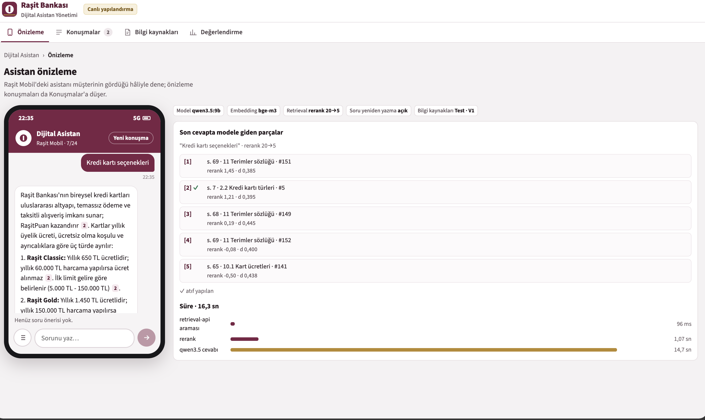
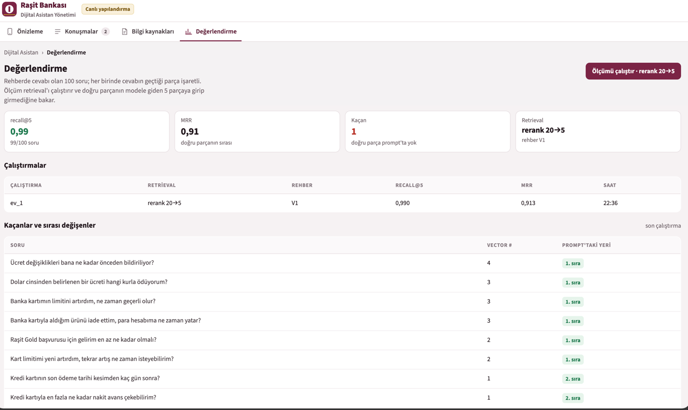

# RAG Asistan · Kullanım Kılavuzu





Gerekenler: macOS + Homebrew, Docker Desktop, Java 26, Node 26, IntelliJ.

```bash
git clone https://github.com/mrasitesdmr/rag.git
cd rag
```

Komutlar repo kökünden çalışır. Backend'ler IntelliJ'den çalıştırılır (assistant-api 8090, retrieval-api 8080).

## 1. Kurulum (bir kez)

```bash
brew install ollama llama.cpp
brew services start ollama
ollama pull qwen3.5:9b
ollama pull bge-m3
```

## 2. Modelleri çalıştır

Üç model, iki komut. Ollama `qwen3.5:9b` (dil modeli) ve `bge-m3` (embedding) modellerini birlikte servis eder; backend ilk istediğinde belleğe alır.

```bash
brew services start ollama
tail -f /opt/homebrew/var/log/ollama.log   # loglar (Ctrl+C sadece izlemeyi bırakır)
ollama ps                                  # bellekteki modeller
brew services stop ollama                  # kapatma
```

`bge-reranker-v2-m3` (reranker), ayrı terminalde, açık kalır; Ctrl+C ile durur:

```bash
llama-server -hf gpustack/bge-reranker-v2-m3-GGUF:Q8_0 --reranking --host 127.0.0.1 --port 8081 --ctx-size 8192 --batch-size 2048 --ubatch-size 2048 --n-gpu-layers 99
```

## 3. Veritabanını ayağa kaldır (compose)

```bash
docker compose -f deployment/docker-compose.dev.yml up -d
```

## 4. Backend'leri IntelliJ'den çalıştır

Önce `RetrievalApplication` (8080), sonra `AssistantApplication` (8090). Ek ayar gerekmez.

## 5. Web'i çalıştır

```bash
cd web
npm install
npm run dev
```

Adres: http://localhost:5173

## Kapatma

```bash
docker compose -f deployment/docker-compose.dev.yml down      # veri kalır
docker compose -f deployment/docker-compose.dev.yml down -v   # veri de silinir
brew services stop ollama
```

Reranker: çalıştığı terminalde Ctrl+C.
